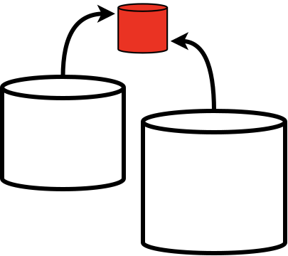

# Semantic Background

{: width="40%" }

KurrawongAI's _Semantic Background_ is a set of reference semantic web information we use to align and augment project data.

The Semantic Background contains:

* **Ontologies**: 50 or so well-known W3C, OGC and other standards bodies' models
* **Vocabularies**: several hundred [SKOS](https://www.w3.org/TR/skos-primer/) classification vocabularies we have worked on with many Australian and international organisations
* **Validators**: 100 or so [SHACL](https://www.w3.org/TR/shacl/) Shapes Graphs that can be used to validate RDF data

## Access

The Semantic Background's content is available in files in version control at:

* <https://github.com/kurrawong/semantic-background>

The content is also loaded into a publicly-accessible [SPARQL Endpoint](https://www.w3.org/TR/sparql12-protocol/) so it can be queried as a single Knowledge Graph.

## Tools

The Semantic Background is used by our [kgm](../products/tools/kgm.md) and [kurra](../products/tools/kurra.md) to supply validators and labels, so commands like `kurra shacl validate...` use it directly.

## Customised Access

If you'd like to access the Semantic Background in some other way, please [let us know](https://kurrawong.ai/about-us/get-in-touch)!